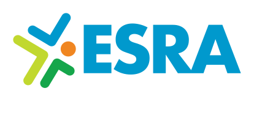
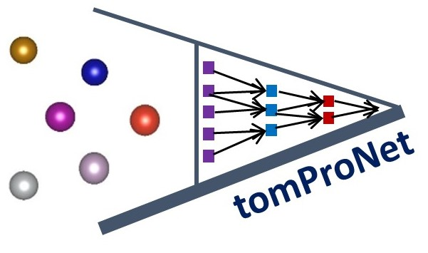
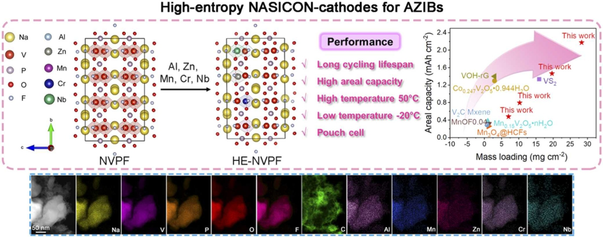
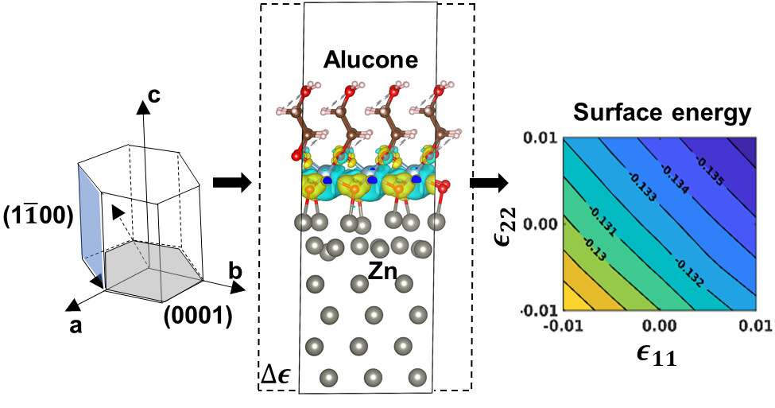
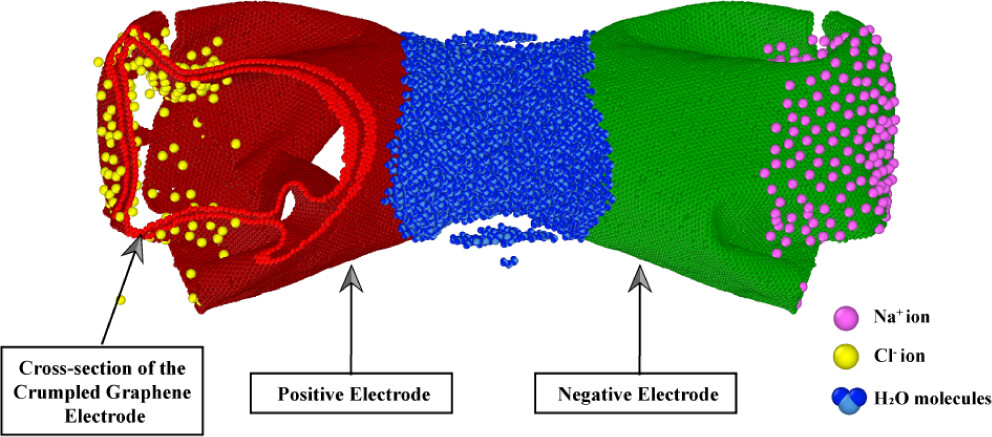

<h3>Software</h3>

  <a href="https://github.com/MusannaGalib/AtomProNet">AtomProNet</a> ·
  <a href="https://github.com/MusannaGalib/SurfTrack">SurfTrack</a> ·
  <a href="https://github.com/MusannaGalib/MOOSEanalyze">MOOSEanalyze</a> ·
  <a href="https://data.energystoragera.org/data">ESRA Data Platform</a>

  <h3>FAIR Data Infrastructure for Energy Storage</h3>
  2026 – present

The <a href="https://data.energystoragera.org/data">ESRA Data Platform</a> at Argonne National Laboratory, built end to end: data ingestion and a FAIR (findable, accessible, interoperable, reusable) catalog, a web interface, an MCP server that connects the catalog to AI assistants, and analysis agents that turn raw instrument files into audited, traceable results.

Backend · Frontend · DevOps · MCP server · Data catalog · Analysis agents · Audit trails

  

    
  

  

    
  

  <h3>Interatomic Potentials for Materials Science</h3>
  2023 – 2025

Machine-learning interatomic potentials, built on equivariant graph neural networks. <a href="https://www.youtube.com/watch?v=na10M4NbdfM">Talk (video) ↗</a>

  

    
  

  

    
  

  <h3>Dendrite Inhibition</h3>
  2021 – 2025

Suppressing dendrite-driven short circuits in rechargeable metal batteries. <a href="https://www.youtube.com/watch?v=4Q30xnX-hcc">Talk (video) ↗</a>

  

    
    
  

  

    
  

  <h3>Supercapacitors</h3>
  2019 – 2024

Electrode design for supercapacitors.

  

    
  

  

    
  

  <h3>Other Publications</h3>

Book chapter, thermal and energy systems, and engineering education.



* equal contribution

